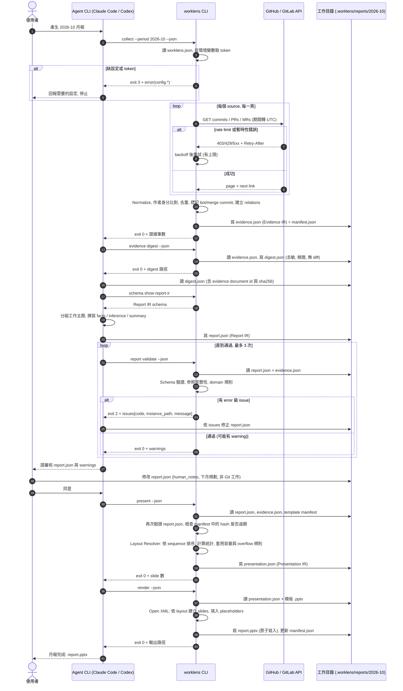

# WorkLens — MVP Pipeline Sequence

> Status: Proposed — 2026-11-11
> 對應交接文件 §10 交付物 4: Git API → Normalization → Analysis → Validation → Layout Resolution → Rendering。
> 在 v0.1 中 Analysis 由 agent CLI 執行 ([ADR-0004](../adr/0004-agent-as-analyzer.md))。命令與 exit codes 見 [cli-ux.md](cli-ux.md)。

## 補充

- **確定性區段**: `present` 與 `render` 只依賴檔案內容與版本; 以同一份已審核的 `report.json` 重跑, 得到相同的 Presentation IR 與相同的 slide 結構與文字 (交接文件 §1.1 原則 5)。重跑不需要 agent。
- **過期偵測**: 若 `evidence.json` 在 `report.json` 之後被重新產生 (hash 改變), `present` 回 exit 5; 執行 `worklens report rebind` (所有參照仍存在時更新綁定) 後重新 `report validate`。
- **人工介入點**: 「請審核 report.json 與 warnings」之後的人工審核是必要的; v0.1 不提供自動跳過審核的選項。
- **失敗處理**: 每個命令失敗時不覆寫既有輸出檔; agent 依 exit code 決定重試、修正或回報 (cli-ux.md §6)。
