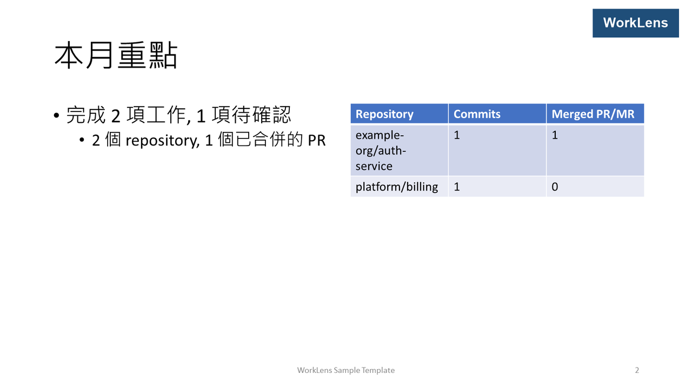
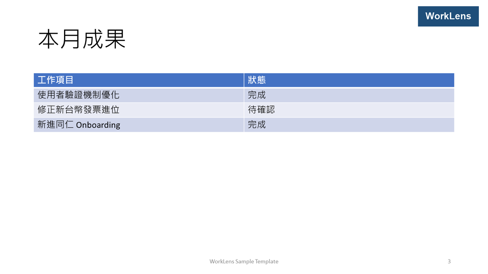
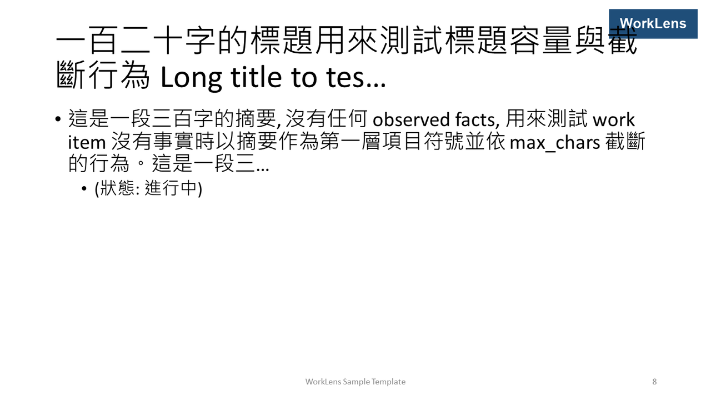
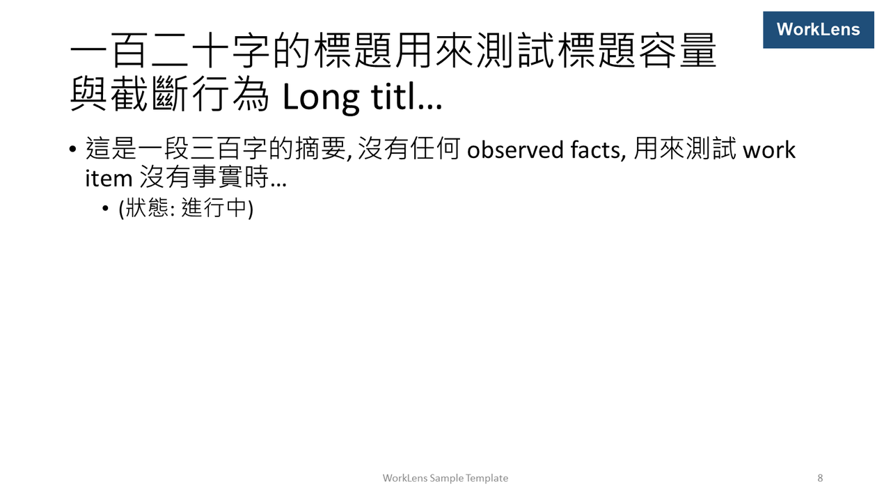
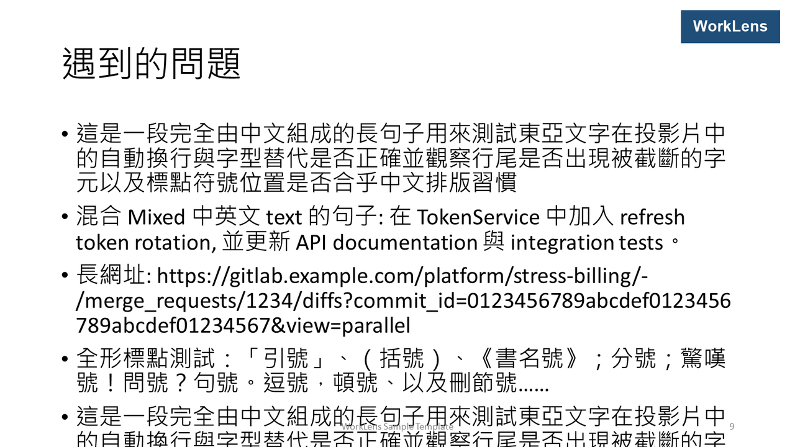
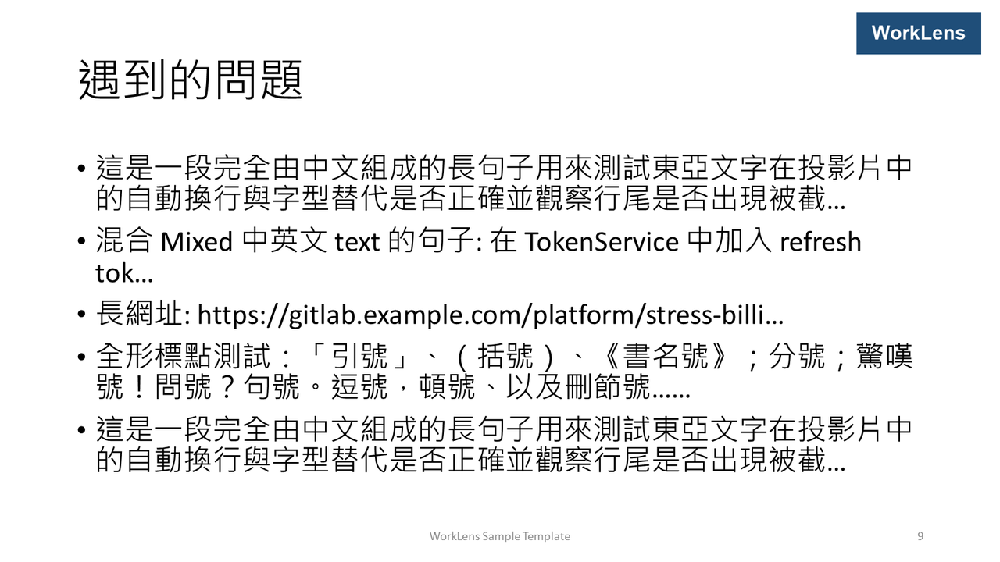
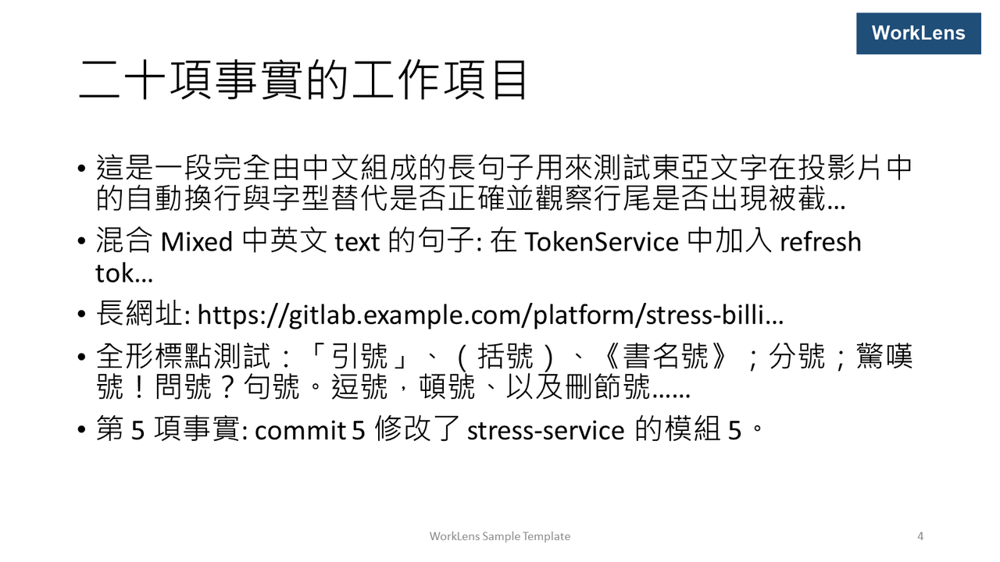
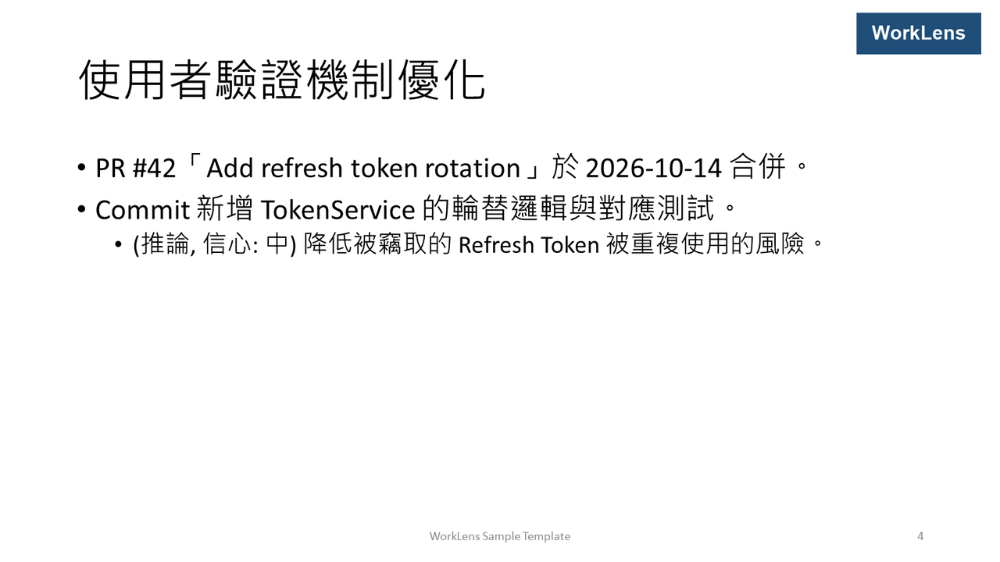

# WorkLens — PPTX Template PoC Report (M0)

> Status: Completed — 2026-11-11
> 計畫: [pptx-poc-plan.md](pptx-poc-plan.md); 決策對象: [ADR-0006](../adr/0006-pptx-open-xml-sdk.md)。
> 結論: P1–P4、P7–P10 通過; P5、P6 有記錄的結果與決策 (容量校正); P11 v0.1 不執行。建議 ADR-0006 改為 **Accepted** (使用者已於 2026-11-12 決定 Accepted)。

## 環境與輸入

- 模板: `templates/sample-monthly/sample-monthly.pptx`, 由 `build-template.ps1` 以 PowerPoint COM 產生 (UI 語系 zh-TW; layout / placeholder 名稱以 COM 明確設為英文)。Layouts: `Title Slide`、`Title and Content`、`Title and Table` (`tbl` placeholder idx 13)、`Two Content`; master 含 logo 圖片、頁尾文字、頁碼。
- 渲染: `src/WorkLens.Rendering.Pptx` (DocumentFormat.OpenXml 3.5.1), 經 `worklens present` → `worklens render`。
- 範例案例: `schemas/{report-ir,evidence}/1.0/examples/valid/` → 8 頁。
- 壓力案例: `tests/Fixtures/stress/` → 11 頁 (20 facts 的 work item、120 字標題、300 字無 facts 的摘要、7 則 challenge; 純中文、中英混合、長 URL、全形標點)。
- PowerPoint 檢查: `tools/poc/run-poc-checks.ps1` (本機 PowerPoint (Office16), COM; 每頁 1600×900 PNG 匯出)。
- 結構檢查: `tests/WorkLens.Rendering.Pptx.Tests` (不需 Office, 17 個測試)。

## P1 Placeholder 填值

**通過。** 每個 slot 以 manifest 的 `idx` 或 `name` (`p:cNvPr/@name`) 在 layout 中定位, 在 slide 上建立帶相同 `p:ph` 的 shape, `spPr` 留空以繼承位置。`idx = 0` 也匹配沒有 idx 的 `title` / `ctrTitle`。未綁定的選填 slot 不建立 shape: 省略 cover `subtitle` 的測試斷言該 slide 沒有 idx 1 的 shape, 因此不會出現「按一下以新增文字」。測試: `PptxRendererTests` 的 P1 斷言與 unbound subtitle 測試。

## P2 Slide 建立

**通過。** 每張 slide 由 layout 建立 (不複製 prototype slide); 模板的示範 slides 與其 notes slides 全部刪除; `sldId` 由 256 起遞增且唯一; 每頁 layout 名稱與 Presentation IR 一致 (同一 layout 多頁亦然, 例如 stress 案例 4 頁 `Title and Content`)。Slide relationship id 以「現有最大 rId + 1」明確指定 (SDK 預設為隨機 id, 會破壞確定性)。

## P3 項目符號層級

**通過。** `bullets` 的 `level` 以 `a:pPr lvl` 寫出 (level 0 省略), 縮排與字型大小沿用模板的 body 樣式; L1 推論 / 狀態 / 人工補充行在 PowerPoint 中正確縮排 (截圖 `monthly-04-work-item.png`)。

## P4 表格

**通過。** 表格以 `p:graphicFrame` + 相同的 `p:ph` 建立, `p:xfrm` 取 layout shape 的位置, layout 沒有時取 master 對應 placeholder 的位置 (缺 `p:xfrm` 會讓 PowerPoint 開檔失敗)。等寬欄、`firstRow` + `bandRow`、`tableStyleId` = 模板 `tableStyles.xml` 的預設樣式。涵蓋兩種 placeholder:

- `Two Content` 的 content placeholder (summary 的 activity 表格, `monthly-02-summary.png`)。
- `Title and Table` 的 `tbl` placeholder (achievements 表格, `monthly-03-achievements.png`)。

PowerPoint 中修改儲存格 (2, 1)、存檔、重開後內容保留 (P8)。

## P5 Overflow

**有記錄的結果與決策: 以容量控制, 不依賴自動縮小。**

觀察 (校正前, 模板 sha256 `e2303443…`):

1. stress slide 9 (challenges, 6 項、無 `max_chars`) 的文字溢出到頁尾以下。Layout 的 body 有 `normAutofit`, 但 PowerPoint 在開檔與匯出時不計算 `fontScale`, 自動縮小只在使用者編輯該文字框時才發生。Renderer 無法量測文字, 因此 `normAutofit` 不能當作後備。
2. stress slide 8 的 40 字標題換成 2 行, 第 1 行右端壓到 master 的 logo (title placeholder 全寬; 單行標題不會碰到)。

量測 (28pt body, `Title and Content`): 一行約 28 個全形字, 約 10 行; `Two Content` 半寬約 14 字 / 行; 標題 44pt; 表格 18pt。

決策 (commit `dee0f27`):

- 模板: master title 的寬度縮到 logo 左側 12pt (寬 9448800 EMU); 各 layout 的 title 繼承此位置。新 sha256 `07cfe14e…daa1f1`。
- Manifest 容量以「全部是全形字」的最壞情況計, 每項 ≤ 2 行、總行數 ≤ 10:

| Layout / slot | 校正前 `max_chars` / `max_items` | 校正後 |
|---|---|---|
| cover `title` | 60 / — | 24 / — |
| 其他 `title` | 40 / — | 32 / — |
| summary `highlights` | 80 / 6 | 28 / 5 |
| summary `activity` (表格) | — / 8 | 30 / 5 |
| achievements `items` (表格) | 40 / 8 | 40 / 6 |
| work item `facts` | 90 / 5 | 54 / 5 |
| narrative `body` | — / 6 | 54 / 5 |

第一次試 58 字時, 全形 58 字仍換到第 3 行 (一行實際 28 字), 因此改為 54 (含 `…` 共 54 字, 2 行)。校正後 stress 11 頁全部無溢出、標題不壓 logo; 範例案例的 golden 與 renderer snapshot 不變 (範例文字都短於新容量)。拆頁 (`split`) 設 `continuation`, 截斷加 `…` 並設 `truncated: true` (`LayoutResolverTests`)。

| 校正前 | 校正後 |
|---|---|
|  |  |
|  |  |

已知限制: 容量以全形最壞情況計, 英文為主的句子大約在一半寬度就被截斷 (寬度意識的 `max_chars` 記入 backlog)。

## P6 中文換行

**有記錄的結果: PowerPoint 中無問題。** 只以 PowerPoint 驗證 (使用者決定不做跨檢視器驗證, 見 P11)。

- 無字元遺失或亂碼 (純中文、中英混合、全形標點)。
- 標點不出現在行首: 全形標點測試行 (「引號」、(括號)、《書名號》、分號、驚嘆號、問號、句號、逗號、頓號、刪節號) 依 PowerPoint 的東亞換行規則斷行。
- Run 沒有 `a:rPr` (因此沒有 `lang`), PowerPoint 仍依主題的東亞字型 (Microsoft JhengHei) 與拉丁字型 (Calibri) 為每個字元選字型; 沒有觀察到因缺少 `lang` 造成的字型或換行差異。
- 長 URL 在 `/` 與字串中斷行; 截斷後的 `…` 顯示正確。
- Activity 表格的 repository 欄為 1/3 寬, 長名稱會換 2–3 行 (可接受)。

## P7 樣式保持

**通過。** 輸出的 run 不含 `a:rPr` (沒有 `latin` / `ea` / `solidFill` / `sz` 覆寫), 字型、顏色、大小全部繼承模板; PowerPoint 截圖與模板樣式一致。Master 的 logo (`p:pic` 與 image part)、頁尾文字 (`ftr`) 與頁碼 (`sldNum` 的 `a:fld type="slidenum"`) 保留在每一頁; 每頁 `cNvPr/@id` 唯一。

## P8 可編輯性

**通過。** `run-poc-checks.ps1` 對範例 (8 頁) 與壓力 (11 頁) 案例: PowerPoint COM 開檔無例外、無修復提示 (300 秒逾時未觸發); 修改 slide 1 的 placeholder 文字、修改表格儲存格 (2, 1)、把最後一頁切換到 `Two Content`、`SaveAs` 另存 `edited.pptx`, 重新開啟後三項修改與頁數皆保留。腳本 exit 0。

觀察: 每次 `Quit()` 後 POWERPNT 仍會存活約 30 秒, 腳本在等待 30 秒後 kill 自己啟動的 PID (設計中的後備路徑, 每次都會走到); 被 kill 的 process 會短暫以 `HasExited = true` 留在 `Get-Process`, 腳本以此過濾。

## P9 檔案有效性

**通過。** `OpenXmlValidator(FileFormatVersions.Office2019)` 對範例與壓力案例的輸出皆為 0 個錯誤 (`PptxRendererTests`)。

## P10 確定性

**通過。** 同一 Presentation IR 渲染兩次, 抽取的正規化 JSON (layout 名稱、placeholder 識別、段落文字與層級、表格; 不含 rId / part URI / 時間) 相同, 且等於 `tests/WorkLens.Rendering.Pptx.Tests/Snapshots/monthly.json`。`worklens present` 對同一輸入的輸出位元組相同, 且等於 golden `monthly-presentation.json`。不比較 `.pptx` 二進位雜湊。

## P11 跨檢視器

**v0.1 不執行: 使用者決定不做跨檢視器 (LibreOffice 等) 驗證。** 輸出只以 PowerPoint 驗證。觸發重新評估的條件: 得知收件人使用非 PowerPoint 檢視器 (LibreOffice、Google Slides、Keynote), 或 M4 需要在 Linux CI 做轉檔檢查。

## 文件屬性 (security-privacy §8)

- 模板: `build-template.ps1` 存檔前清除 `Author` / `Title` / `Last Author` 並設定 `RemovePersonalInformation`。
- 輸出: core props 只有 `title` (cover 標題) 與 `creator = WorkLens`; app props 只有 `Application = WorkLens` 與 `Slides`; 刪除 notes slides、comment authors、custom props 與 thumbnail (PowerPoint 每次存檔都把第一張示範 slide 寫成 thumbnail); 移除 `presentation.xml` 的 `removePersonalInfoOnSave`。

## 已知風險

| 風險 | 影響 | 處理 |
|---|---|---|
| 未驗證非 PowerPoint 檢視器 | LibreOffice / Google Slides / Keynote 的換行、字型替代與表格樣式可能不同 | Backlog: 跨檢視器驗證, 依 P11 的觸發條件重新評估 |
| `normAutofit` 不會在開檔時縮小文字 | 超過容量的文字會溢出 | 容量以全形最壞情況校正; 換模板時依 pptx-poc-plan §6 重新校正 |
| 容量以全形最壞情況計 | 英文為主的句子提早截斷 | Backlog: 寬度意識的 `max_chars` |
| `Quit()` 後 POWERPNT 殘留約 30 秒 | PoC 腳本每個檔案多等 30 秒, 並 kill 自己啟動的 PID | 只影響 PoC / 模板建置腳本; Renderer 本身不使用 Office |
| 只驗證了自製樣本模板 (OQ-04) | 企業模板可能有 SmartArt、chart 或不同的繼承鏈 | 換模板時依 pptx-poc-plan §6 重驗 |

## ADR-0006 建議

**建議: Accepted。** 依據:

- 需要 Open XML SDK 證明的項目 (P1–P4、P7、P9、P10) 全部以不需 Office 的結構測試通過; P8 在 PowerPoint 中通過。
- 「由 layout 建新 slide」策略避開了 slide 複製的關聯 part 問題; 實作中沒有遇到需要 ShapeCrawler 高階 API 的情況。
- 唯一的實質問題 (P5 溢出) 與 SDK 無關: 任何不量測文字的 renderer 都要靠容量控制; 以模板調整與容量校正解決。
- Aspose.Slides 的主要優勢 (文字量測、渲染成圖片) 在 v0.1 不是必要條件, 且 OQ-11 授權預算未定。
